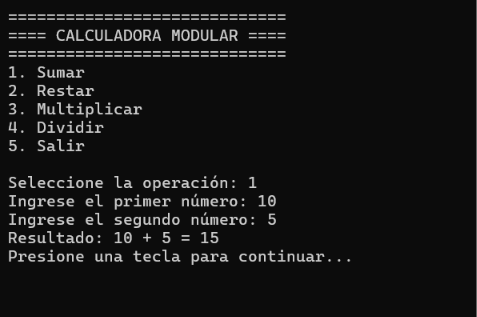

# Calculadora Modular en C#

Laboratorio 4.6 — **Fundamentos de Programación con C#** · CodeArt Academy · Programa FullStack .NET Cloud Developer

Aplicación de consola que permite sumar, restar, multiplicar y dividir dos números decimales mediante un menú interactivo. Cada operación matemática está implementada en un método independiente que recibe sus operandos como parámetros y retorna el resultado.

## Funcionalidades

- Menú interactivo que se repite hasta seleccionar **Salir**.
- Cuatro operaciones: suma, resta, multiplicación y división.
- Validación de la opción del menú (valores no numéricos y fuera del rango 1–5).
- Validación de números con `decimal.TryParse()`: si el dato no es numérico, se vuelve a solicitar.
- Prevención de división entre cero: se muestra un error y el programa continúa.
- Código modularizado: menú, captura de datos, cálculos y presentación en métodos separados.

## Requisitos

- [.NET SDK 10](https://dotnet.microsoft.com/download) o superior
- Visual Studio 2022 / 2026, Visual Studio Code o cualquier terminal

Verifica la instalación con:

```bash
dotnet --version
```

## Ejecución

1. Clonar el repositorio:

   ```bash
   git clone https://github.com/DHDanaurysHiraldo/4.6_Laboratorio-CalculadoraModular.git
   cd 4.6_Laboratorio-CalculadoraModular
   ```

2. Ejecutar la aplicación:

   ```bash
   dotnet run
   ```

   También puedes abrir el archivo `.slnx` en Visual Studio y presionar **F5**.

## Uso

```text
=============================
==== CALCULADORA MODULAR ====
=============================
1. Sumar
2. Restar
3. Multiplicar
4. Dividir
5. Salir

Seleccione la operación:
```

Selecciona una opción del 1 al 4, ingresa los dos números y se mostrará el resultado. La opción 5 finaliza el programa.

> **Nota:** los decimales se ingresan con **punto** (por ejemplo, `2.5`). El programa usa `CultureInfo.InvariantCulture`, por lo que funciona igual sin importar la configuración regional del equipo.



## Estructura del proyecto

```text
4.6_Laboratorio-CalculadoraModular/
├── docs/
│   ├── pseudocodigo.md      # Pseudocódigo del algoritmo principal
│   └── evidencias/          # Capturas de los casos de prueba (CP-01 a CP-11)
├── Program.cs               # Código fuente de la calculadora
├── *.csproj                 # Archivo del proyecto
├── *.slnx                   # Archivo de la solución
└── README.md
```

## Métodos implementados

| Método | Responsabilidad |
|---|---|
| `MostrarMenu()` | Muestra las opciones disponibles |
| `LeerOpcion()` | Lee y valida la opción del menú; retorna `0` si no es válida |
| `Pausar()` | Espera una tecla para que el usuario pueda leer los mensajes |
| `EjecutarOperacion(int opcion)` | Solicita los números y ejecuta la operación elegida |
| `LeerDecimal(string mensaje)` | Solicita un número hasta que sea válido |
| `MostrarResultado(...)` | Presenta la operación, los operandos y el resultado |
| `Sumar(decimal a, decimal b)` | Retorna `a + b` |
| `Restar(decimal a, decimal b)` | Retorna `a - b` |
| `Multiplicar(decimal a, decimal b)` | Retorna `a * b` |
| `Dividir(decimal a, decimal b)` | Retorna `a / b` (se invoca solo si `b != 0`) |

## Casos de prueba

| ID | Escenario | Resultado esperado | Estado | Evidencia |
|---|---|---|---|---|
| CP-01 | Sumar 10 + 5 | 15 | ✅ Aprobado | [Ver](docs/evidencias/CP-01-suma.png) |
| CP-02 | Restar 10 - 5 | 5 | ✅ Aprobado | [Ver](docs/evidencias/CP-02-resta.png) |
| CP-03 | Multiplicar 10 × 5 | 50 | ✅ Aprobado | [Ver](docs/evidencias/CP-03-multiplicacion.png) |
| CP-04 | Dividir 10 / 5 | 2 | ✅ Aprobado | [Ver](docs/evidencias/CP-04-division.png) |
| CP-05 | Dividir 10 / 0 | Mensaje de error; menú continúa | ✅ Aprobado | [Ver](docs/evidencias/CP-05-division-entre-cero.png) |
| CP-06 | Introducir ABC como número | Solicita el dato nuevamente | ✅ Aprobado | [Ver](docs/evidencias/CP-06-entrada-invalida.png) |
| CP-07 | Seleccionar opción 9 | Opción inválida; menú continúa | ✅ Aprobado | [Ver](docs/evidencias/CP-07-opcion-invalida.png) |
| CP-08 | Sumar -10 + 5 | -5 | ✅ Aprobado | [Ver](docs/evidencias/CP-08-suma-negativo.png) |
| CP-09 | Sumar 2.5 + 1.5 | 4 | ✅ Aprobado | [Ver](docs/evidencias/CP-09-suma-decimales.png) |
| CP-10 | Ejecutar dos operaciones consecutivas | Ambas se ejecutan sin reiniciar | ✅ Aprobado | [1](docs/evidencias/CP-10a-primera-operacion.png) · [2](docs/evidencias/CP-10b-segunda-operacion.png) |
| CP-11 | Seleccionar opción 5 | Mensaje de despedida y finalización | ✅ Aprobado | [Ver](docs/evidencias/CP-11-salir.png) |

Todas las capturas se encuentran en [`docs/evidencias/`](docs/evidencias/).

## Matriz de trazabilidad

| Requerimientos | Reglas de negocio | Casos de prueba |
|---|---|---|
| RF-01, RF-02, RF-12, RF-13 | RN-01, RN-06, RN-07 | CP-07, CP-10, CP-11 |
| RF-03, RF-08 | RN-02, RN-07 | CP-06, CP-09 |
| RF-04, RF-05, RF-06 | RN-04, RN-05 | CP-01, CP-02, CP-03, CP-08, CP-09 |
| RF-07, RF-09 | RN-03, RN-04, RN-05 | CP-04, CP-05 |
| RF-10, RF-11, RF-14 | RN-04, RN-05, RN-06 | CP-01 a CP-04, CP-10 |

## Autor

**Danaurys Hiraldo** — [@DHDanaurysHiraldo](https://github.com/DHDanaurysHiraldo)